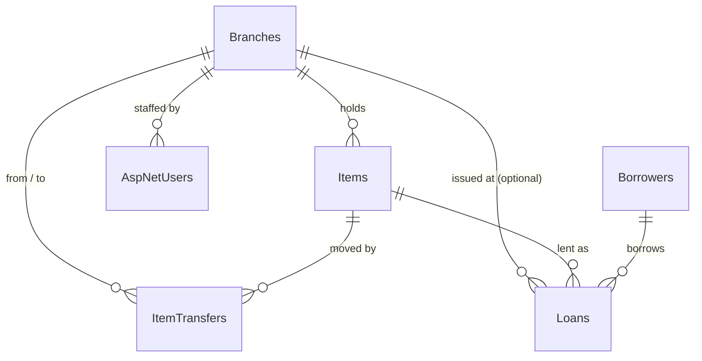
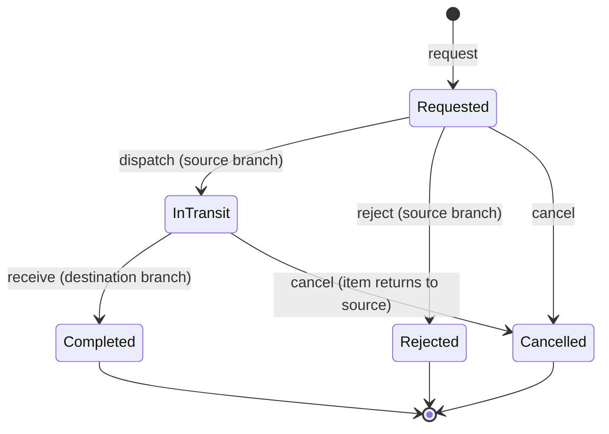
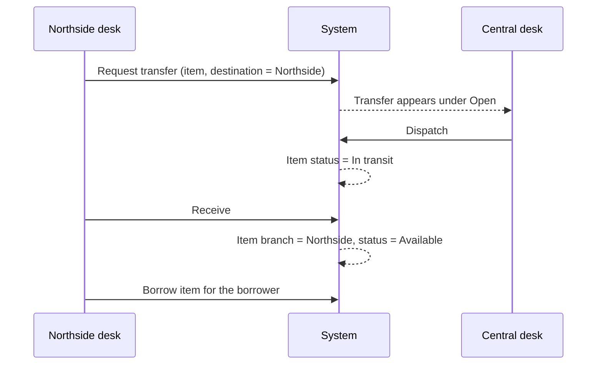

# Section 1 — Multi-Branch Inventory and Manager Analytics

Branch: `feature/multibranch-manager-analytics`
Baseline: Assignment 2 Library Management System (ASP.NET Core MVC, EF Core, SQLite, ASP.NET Core Identity)

## 1. What this section adds

**Feature A — Multi-branch inventory**

- Library branches with a code, name, address and phone number.
- Every item belongs to one physical branch. Admin chooses the branch on the item form.
- Staff accounts can be assigned to a branch. A Reception account's branch is its reception desk.
- Inter-branch transfers with a request → dispatch → receive workflow, plus cancel and reject.
- Branch shown and filterable on the public search, the admin item list, the loans list and the reports.

**Feature B — Manager analytics and export**

- Expanded dashboard: total inventory, per-status counts, per-branch inventory and loans, fines.
- Three filterable reports: Borrowing Statistics, Fine Revenue Audit, Inventory Health.
- Each report downloads as CSV and as PDF, using the filters selected on the page.

## 2. Multi-branch requirements and how they are met

| Requirement | Implementation |
|---|---|
| Multiple physical branches | `Branch` entity, `BranchesController`, `Views/Branches` |
| Items track which branch holds them | `Item.BranchId` (required), set on the item form, shown on lists and details |
| Reception desks tied to a branch | `ApplicationUser.BranchId`, set on the Staff form; shown in the page header |
| Staff coordinate inter-branch transfers | `ItemTransfer` entity, `TransferService`, `TransfersController` |
| Existing data preserved | Migration assigns every existing item to the default branch (Id 1, Central Library) |

## 3. Database changes

Migrations: `20261011081635_AddBranchesAndTransfers` and `20261011084119_AddItemMovementKind`

| Table | Change |
|---|---|
| `Branches` (new) | `Id`, `Code` (unique), `Name`, `Address`, `Phone`, `IsActive`. One row is inserted: Id 1, `CEN`, Central Library |
| `ItemTransfers` (new) | `Kind`, `ItemId`, `FromBranchId`, `ToBranchId`, `Status`, `Reason`, `RequestedAt/By`, `DispatchedAt/By`, `ClosedAt/By`, `ClosureNote` |
| `Items` | `BranchId` INTEGER NOT NULL, default 1, foreign key to `Branches` |
| `AspNetUsers` | `BranchId` INTEGER NULL, foreign key to `Branches` |
| `Loans` | `BranchId` INTEGER NULL (issuing branch), foreign key to `Branches` |

All foreign keys use `ON DELETE RESTRICT`. `ItemTransfers` has a unique partial index on `ItemId` where `Status IN (0, 1)`, so the database itself allows at most one open transfer per item.

`ItemTransfers.Kind` says why the item's branch changed: `Transfer` (0, the shipped workflow), `Correction` (1, an Admin fixed a wrong record) or `CrossBranchReturn` (2, a borrower handed the item back at another branch). The table is therefore the complete movement history of every item.

The second migration also assigns every existing Reception account to the default branch, because before the upgrade there was only one location.

`ItemStatus` gained a fifth value, `InTransit` (4). It was appended, so the stored values for Available (0), Borrowed (1), Damaged (2) and Destroy (3) are unchanged.



## 4. Managing branches

Sign in as Admin and open **Branches**.

- **Add Branch**: code (letters, numbers, hyphens; max 10; saved in capitals; unique), name (unique), address, optional phone.
- **Edit**: change code, name, address or phone.
- **Inventory**: the branch page lists the items held there (filter by status), open transfers and assigned staff.
- **Deactivate**: only when the branch holds no items, has no open transfers and no staff. An inactive branch keeps its history but cannot be chosen for items, transfers or staff.
- **Delete**: only when the branch has no items, staff, transfer history or loan history. Otherwise deactivate it.
- The default branch (Central Library) cannot be deactivated or deleted.

Reception and Manager accounts can view branches and their inventory but cannot change them.

To assign staff: **Staff → Edit** and choose the branch. A Reception account must have a branch.

**Item location rules**

| Situation | How | Recorded as |
|---|---|---|
| New item | Choose the branch on **Items → Add Item** | The item's first location (no movement record) |
| Item is physically sent to another branch | **Transfers → Request Transfer** | Transfer |
| The record is wrong (item is already elsewhere) | **Items → View → Correct location**, reason required | Location correction |
| Borrower returns the item at another branch | Automatic when that desk processes the return | Returned at another branch |

The branch of an existing item cannot be changed on the item edit form. A correction is refused while the item is on loan, in transit or has an open transfer, and it never changes the item's status.

## 5. Inter-branch transfers



| Step | Item status | Item branch |
|---|---|---|
| Requested | Available (still on the shelf, can still be borrowed) | Source |
| In transit | In transit (cannot be borrowed) | Source |
| Completed | Available | **Destination** |
| Cancelled / Rejected | Available | Source |

**Business rules**

1. Only an item that is Available, has no open loan and has no open transfer can be requested.
2. Borrowed, Damaged, Destroy and In transit items are refused with a message saying why.
3. Source is always the branch that currently holds the item; destination must be a different, active branch.
4. Dispatch re-checks that the item is still Available at the source. If it was borrowed in the meantime, dispatch fails and the loan is untouched.
5. The item's branch changes only when the destination receives it.
6. A transfer can be completed once. A second attempt is refused; two simultaneous attempts are resolved by a concurrency check so only one succeeds.
7. While an item has an open transfer, Admin cannot change its status on the item form or correct its location. "In transit" cannot be chosen by hand.
8. An item or branch that appears in transfer history cannot be deleted.

**Who can do what**

| Action | Admin | Reception |
|---|---|---|
| View transfers | Yes | Yes |
| Request | Any item, any destination | Item from own branch, or any item to own branch |
| Dispatch / Reject | Yes | Staff at the source branch |
| Receive | Yes | Staff at the destination branch |
| Cancel | Yes | Staff at the source or destination branch |

A Reception account with no branch can view transfers but not act on them. Managers have no access to transfers. All of these rules are enforced on the server; hiding a button is never the only check.

**User journey: a borrower at Northside wants a book held at Central**



## 6. Reception desks and loans

- A Reception account can only lend items held at its own branch. Trying to lend another branch's item shows where the item is and suggests a transfer.
- A Reception account with no branch cannot lend or accept returns at all. It sees a message asking for an Admin to assign a branch. New Reception accounts cannot be saved without a branch.
- Each new loan records the branch that held the item as its **issuing branch**.
- Loan period, fine rate and fine calculation are unchanged.

**Cross-branch return policy**

Returns are accepted at any branch's desk, because turning a borrower away would be worse service and would not make the data any more accurate. When the desk is not the branch that holds the item:

1. The loan is closed and the fine calculated exactly as for any return.
2. The item's branch becomes the desk's branch, because that is where it now physically is.
3. A completed movement record of type "Returned at another branch" is saved (from, to, who, when, loan number), so the change is auditable.
4. If a transfer request for that item was still waiting to be dispatched, it is cancelled with a note, since the item is no longer at the source.
5. The loan's issuing branch is not changed.

The return page tells the desk this will happen before they confirm. To send the item back to its original branch, request a transfer.

## 7. Manager reports

Sign in as Manager and open **Statistics**.

| Report | Filters | Contents |
|---|---|---|
| Borrowing statistics | Borrowed date range, branch, category | Totals (loans, active, returned, overdue, returned late), by category, by issuing branch, by month, top 10 items, loan listing |
| Fine revenue audit | Returned date range, branch, category, paid/outstanding | Assessed, paid, outstanding, collection rate, by branch, by borrower, every fined loan, overdue loans not yet returned |
| Inventory health | Branch, category | Counts per status, availability rate, by branch, by category, items needing attention, full listing |

Notes on accuracy:

- Fine amounts are stored as TEXT by SQLite. All fine totals are calculated in C# as `decimal`, never summed or compared in SQL.
- Loans made before this upgrade have no issuing branch. Reports list them as "Not recorded" rather than guessing.
- The system stores a paid/unpaid flag only. No payment dates or transactions exist, so none are reported.
- "Accruing on overdue loans" is an estimate for items not yet returned and is kept separate from assessed fines.
- "Items needing attention" also flags any item whose status disagrees with its loan record (for example marked Borrowed with no open loan).

## 8. CSV and PDF export

On any report page, choose filters, click **Apply filters**, then **Download CSV** or **Download PDF**. The dashboard cards also have direct CSV and PDF buttons for the unfiltered reports.

- File names: `borrowing-report-YYYYMMDD-HHmm.csv`, `fine-revenue-audit-report-…`, `inventory-health-report-…` (and `.pdf`).
- CSV: UTF-8 with byte order mark (opens correctly in Excel), CRLF line endings, values quoted when they contain commas, quotes or line breaks. Text beginning with `=`, `+`, `-` or `@` is prefixed with an apostrophe so a spreadsheet cannot run it as a formula. Money is written as plain numbers (`7.50`), dates as `yyyy-MM-dd`.
- PDF: A4 landscape, report title, description, filters, generation time, summary cards, tables with a header row repeated on every page, page numbers.
- PDF library: **QuestPDF 2026.9.1**, used under its free Community licence (individuals, education, non-profits and organisations under US$1M revenue). No paid service is used.

## 9. Installing and running

Requirements: .NET 8 SDK (see section 13 for .NET 10). No separate database server is needed.

```bash
git clone https://github.com/Aseshlfc/HIT339_ASSIGNMENT2_S381281_ASHESH-2.git
cd HIT339_ASSIGNMENT2_S381281_ASHESH-2
git switch feature/multibranch-manager-analytics
dotnet restore
dotnet run
```

Open the address printed in the terminal (`http://localhost:5190` with the included launch profile). Sign in with the demo accounts shown on the login page.

**Setting up for several branch locations**

One installation serves every branch: all branches share one database and staff sign in to the same site.

1. Run the application once. The default branch and two demo branches are created.
2. Sign in as Admin. Under **Branches**, rename the default branch to the main location and add, edit or remove branches to match the real locations.
3. Under **Staff**, create a Reception account for each branch desk and assign its branch.
4. Under **Items**, assign items to branches (new items default to the default branch).
5. Staff at other locations browse to the host machine's address. To accept connections from other machines run `dotnet run --urls http://0.0.0.0:5190` and allow the port through the firewall.

## 10. Database migration

Migrations are applied automatically at start-up (`Database.Migrate()` in `Program.cs`). To apply them by hand:

```bash
dotnet tool install --global dotnet-ef   # once
dotnet ef database update
```

- **Existing database**: all rows are kept. Every item is assigned to Central Library; staff and existing loans have no branch.
- **New database**: the seeder also spreads the demo catalogue across three branches, assigns the `reception` account to Central Library and records an issuing branch on the demo loans.
- Back up `library.db` before upgrading a database you care about.

## 11. Testing

```bash
dotnet test Tests/LibraryManagementSystem.Tests.csproj
```

Result on the development machine (macOS, .NET SDK 9.0.316 building `net8.0`): **163 passed, 0 failed, 0 skipped**. This is the original 31 tests, unchanged, plus 132 new test cases.

| Test file | Covers |
|---|---|
| `BranchesControllerTests` | Create, edit, list, invalid input, duplicate code/name, delete and deactivate rules, role restrictions |
| `TransferTests` | Request, dispatch, receive, cancel, reject, every refusal rule, loan preservation, branch-desk permissions, three real-SQLite tests for concurrency and the unique index |
| `BranchIntegrationTests` | Item branch assignment and filter, edit rules, issuing branch on loans, desk lending restriction, public search by branch, staff branch assignment |
| `BaselineRegressionTests` | Borrower CRUD, item CRUD for each type, fine calculation and payment, role restrictions, anti-forgery on every POST, error page |
| `ReportTests` | Report totals, branch/date/category/status filters, empty data, decimal fine totals on real SQLite, CSV escaping and content, PDF validity and content, download responses |

Also checked against the running application:

- Migration applied to a copy of the Assignment 2 database (20 items, 6 loans, 3 users, fine amounts preserved; foreign key and integrity checks clean) and to a new empty database.
- Every new route requested as anonymous, Reception, Manager and Admin; each returned the expected page, login redirect or Access Denied.
- All six exports downloaded with the correct content type and file name.
- Transfer requested, dispatched and received in the browser; item moved from Central Library to Northside Branch.
- Borrow refused at the wrong desk, then borrow and return at the right desk.

- A scripted end-to-end run over HTTP against a new database: logins, anti-forgery and wrong-role POSTs, invalid IDs, branch management, item creation and correction, the whole transfer lifecycle including repeated and simultaneous requests, reception desk rules, cross-branch return, borrowers, staff, public search, and report totals compared with direct SQL counts.
- PDFs rendered to images and inspected, including 8 to 16 page reports built from 130 extra items and 70 extra loans with long names, and an empty report. No text fell outside the page margins.
- Page overflow measured at 1440, 768, 390 and 320 px on 28 pages across the three roles. Wide tables scroll inside their own frame.

**Not verified**

- The designated virtual machine. Installation has only been run on macOS. On the VM, confirm `dotnet restore`, `dotnet run`, sign-in, and one PDF download (QuestPDF loads a native library per platform).
- CSV files were checked as text and against the CSV rules; they were not opened in Excel itself.

## 12. Known limitations

- The project still targets .NET 8 (see section 13).
- Transfers move one item at a time; there is no bulk transfer.
- An item returned at another branch stays there until someone requests a transfer back.
- Reception staff can view every branch's inventory (needed to request transfers) but can only act for their own branch.
- Invalid IDs return a plain 404 response, as in the baseline.
- The demo seeder re-creates the Northside and Riverside demo branches if only the default branch exists at start-up.
- Reports load matching rows into memory before aggregating, which suits a library of this size but would need paging for very large data sets.
- Baseline behaviour that Admin can set an item's status by hand is unchanged, apart from the new transfer-related guards. The Inventory Health report flags any resulting mismatch.

## 13. .NET 10

The assignment asks for .NET 10; the baseline targets .NET 8. This branch does **not** change the target, because it is a project-wide change that affects all three sections.

What the upgrade needs:

1. Install the .NET 10 SDK on every developer machine and the VM (this machine has SDKs 8.0.425 and 9.0.316 only).
2. `LibraryManagementSystem.csproj` and `Tests/LibraryManagementSystem.Tests.csproj`: `<TargetFramework>net10.0</TargetFramework>`.
3. Update `Microsoft.EntityFrameworkCore.Sqlite`, `Microsoft.EntityFrameworkCore.Design`, `Microsoft.AspNetCore.Identity.EntityFrameworkCore` and `Microsoft.EntityFrameworkCore.InMemory` from 8.0.11 to 10.0.x.
4. Rebuild and run all tests.

Section 1 code uses no API specific to .NET 8, QuestPDF 2026.9.1 ships a `net10.0` build, and the EF Core and Identity packages are published at 10.0.12. **The upgrade has not been built or tested**: an attempt to install the .NET 10 SDK into a temporary folder on the development machine failed for lack of disk space. The existing migrations should not need regenerating after the upgrade; confirm with `dotnet ef migrations has-pending-model-changes`.

## 14. Integration notes for Sections 2 and 3

**Shared data**

| Need | Use |
|---|---|
| Where is an item? | `Item.BranchId` (always set). `Branch.DefaultBranchId` (1) is the fallback |
| Can it be borrowed now? | `Item.Status == ItemStatus.Available`. `InTransit` means it is between branches |
| Is it being moved? | `ITransferService.GetOpenTransferForItemAsync(itemId)` |
| Move an item | `ITransferService.RequestAsync / DispatchAsync / ReceiveAsync / CancelAsync / RejectAsync`; each returns `TransferResult(Succeeded, Message, Transfer)` |
| Fix a wrong location | `ITransferService.RecordCorrectionAsync(itemId, toBranchId, reason, actor)` |
| Full movement history | `db.ItemTransfers` filtered by `ItemId`; `Kind` distinguishes transfers, corrections and cross-branch returns |
| Staff member's branch | `db.GetStaffBranchAsync(User)` (`Data/StaffBranchExtensions.cs`) |
| List branches | `db.Branches.Where(b => b.IsActive)` |

**By feature**

- **Kiosk (Section 2)**: a kiosk can identify its branch by a `branchId` and filter with `Item.BranchId`. `HomeController.Index` already accepts `branchId`.
- **REST API (Section 2)**: expose `BranchId` / branch name and treat `InTransit` as a valid status value.
- **CSV import (Section 2)**: set `BranchId` per row. If it is omitted the item lands at the default branch. Validate that the branch exists and is active.
- **Reservations and waitlist (Section 3)**: when a reserved item is at another branch, call `RequestAsync` to bring it over. An item in transit is not Available, so it cannot be lent to someone else on the way.
- **Notifications (Section 3)**: transfer events are the successful results of `DispatchAsync` and `ReceiveAsync`. There is no event bus; call the notification code after a successful result, or wrap `ITransferService`.

**Rules other code must follow**

- Never assign `Item.BranchId` on an existing item directly. Use the transfer service so the move is recorded. Setting it when creating an item is fine.
- Do not set `ItemStatus.InTransit` yourself.
- Returning a loan through `LoansController.Return` may change the item's branch (cross-branch return). Code that returns loans another way should call `ItemMovements.RecordCrossBranchReturnAsync`.
- `Item.Status` and `ItemTransfer.Status` are concurrency tokens. Catch `DbUpdateConcurrencyException` when saving a change to either.
- Do not `Include(i => i.Branch)` in code covered by the existing InMemory tests unless the test seeds a branch; look branch names up from `db.Branches` instead.

**Shared files changed (likely merge conflicts)**

| File | Change |
|---|---|
| `Migrations/LibraryContextModelSnapshot.cs` | Regenerated. Anyone else adding a migration should merge this branch first, then re-create their migration |
| `Data/LibraryContext.cs` | Two `DbSet`s and the branch/transfer configuration appended to `OnModelCreating` |
| `Data/DbSeeder.cs` | Demo branches; branch on seeded reception user and seeded loans |
| `Program.cs` | Three service registrations |
| `Views/Shared/_Layout.cshtml` | Two nav links, branch chip, success alert (`TempData["Success"]`) |
| `wwwroot/css/site.css` | New rules appended at the end only |
| `Models/Item.cs`, `Loan.cs`, `ApplicationUser.cs` | `BranchId` + navigation; `ItemStatus.InTransit` |
| `ItemsController`, `LoansController`, `StaffController`, `HomeController` and their views | Branch field, column and filter; location correction; desk rules on borrow and return; `Home/Error` page |
| `LibraryManagementSystem.csproj` | `QuestPDF` package. Tests project: `PdfPig` (reads PDFs in tests) |

**Repository hygiene (needs a group decision)**

`bin/`, `obj/` and `library.db` are tracked in the baseline commit, so every build and every run shows them as modified. Recommended, as one agreed commit on `main`: add a `.gitignore` for `bin/`, `obj/`, `*.db`, `*.db-shm`, `*.db-wal`, and `git rm --cached` those paths. The database is rebuilt by migrations and the seeder. This branch does not make that change.

## 15. Development summary

1. Located the repository, confirmed the remote, created the feature branch from `main`.
2. Added `Branch` and `ItemTransfer`, branch columns on items, staff and loans, and one migration; tested it on a copy of the existing database and on a new one.
3. Built `TransferService` with the transfer rules, then `BranchesController` and `TransfersController` with their views.
4. Wired branches into items, loans, staff, public search, the seeder and navigation, keeping existing constructor and action signatures compatible so the original tests run unchanged.
5. Built `ReportService`, the CSV writer and the QuestPDF renderer around one shared report model, then the dashboard and report pages.
6. Wrote the test suites and tested the running site by HTTP and in a browser.

## 16. Estimated tasks and hours

Planning estimates for billing purposes, not recorded time. Replace with actual hours from the team's own log.

| Task | Estimate (h) |
|---|---|
| Analysis of baseline and design of branch/transfer model | 3 |
| Database model and migration, upgrade testing | 3 |
| Branch management (controller, views, rules) | 4 |
| Item, staff, loan and search integration | 5 |
| Transfer workflow (service, controller, views) | 7 |
| Report service and three reports | 6 |
| CSV and PDF export | 4 |
| Dashboard and report pages, styling | 4 |
| Automated tests | 7 |
| Manual and browser testing | 3 |
| Documentation | 3 |
| **Total** | **49** |
