# Section 2 User Guide - Kiosk, API and CSV Import

Demo logins: `admin` / `Admin123!`, `reception` / `Reception123!`, `manager` / `Manager123!`.
Demo library cards: **P0001** Alice Nguyen, **P0002** Ben Carter (has an overdue loan), **P0003** Chloe Smith, **P0004** David Lee, **P0005** Priya Patel (has an overdue loan and a $3 unpaid fine).

---

## Part 1 - Using the kiosk (patrons)

No login is needed. Staff open the kiosk page for their branch, for example `/kiosk/CEN` for Central, and leave it on screen. The **Kiosk** link in the menu also opens it.

### Borrow an item
1. **Choose the branch** (only if the kiosk was opened at `/kiosk`). Tap your branch.

   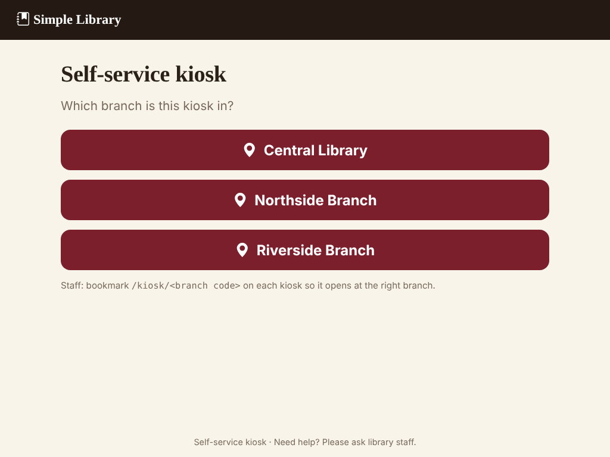

2. **Identify yourself.** Scan your library card or type the number (for example `P0005`) and press Enter or tap **Continue**.

   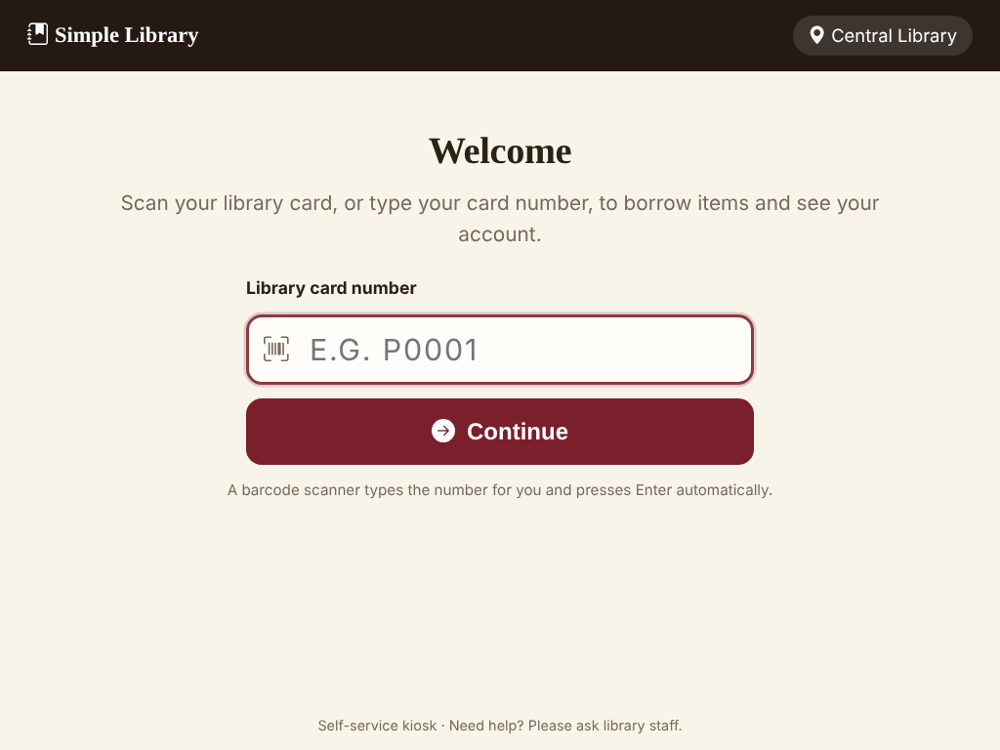

3. **Check your account.** You see what you have borrowed and when it is due, any fines you owe, and your reservations.

   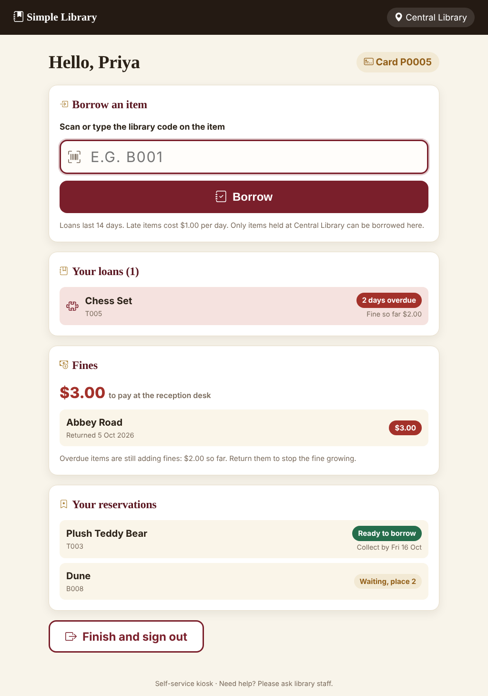

4. **Borrow.** Scan or type the library code printed on the item (for example `B003`) and tap **Borrow**.
5. **Read the confirmation** showing the due date (14 days from today), then tap **Finish**.

   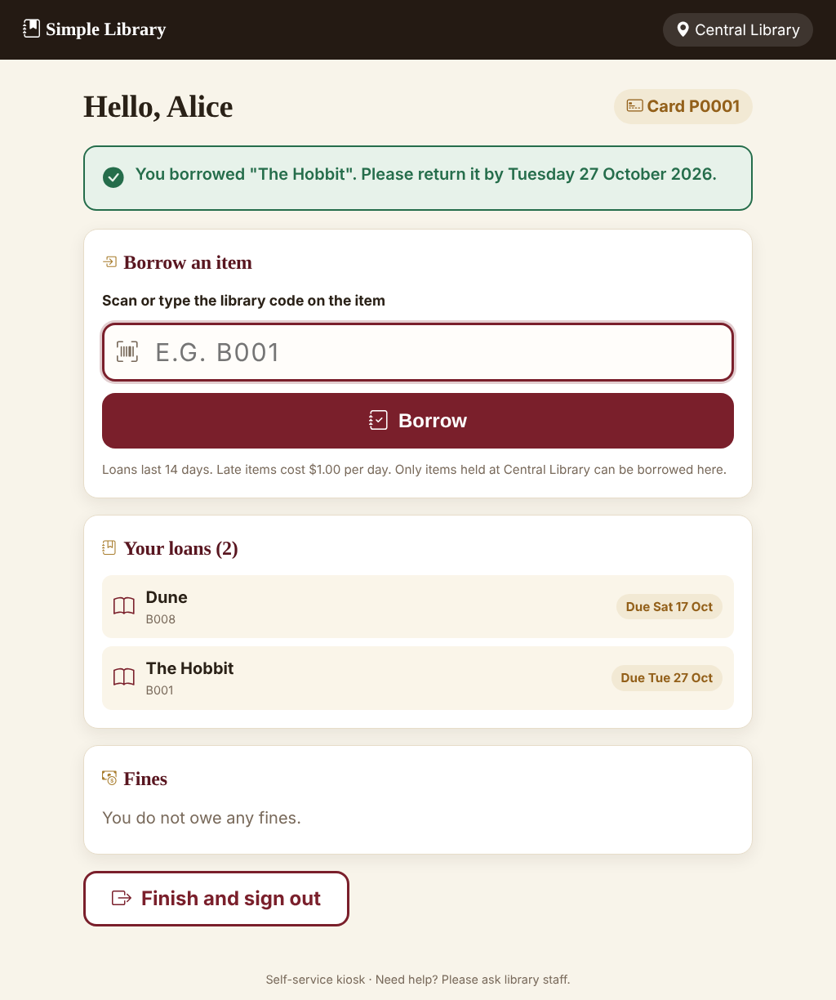

The kiosk signs you out by itself after 60 seconds without use, so the next person cannot see your account.

### Messages you might see
| Message | What it means | What to do |
|---|---|---|
| "That card number was not recognised..." | No patron has that number. | Check the number on your card, or ask at the desk. |
| "No item was found with the code..." | The item code is wrong. | Retype the code from the item's label. |
| "...is currently Borrowed (or Damaged...) and cannot be borrowed." | Someone else has it, or it is being repaired. | Ask library staff to place a hold. |
| "...is held at Northside Branch, not Central Library." | The item belongs to another branch. | Ask staff about a transfer, or go to that branch. |
| "...is being held for another patron who reserved it." | The item is waiting for someone who reserved it. | Ask staff about a hold for yourself. |
| "...was just borrowed by someone else." | Someone borrowed it a moment before you. | Try another copy. |
| "Your session ended. Please scan your library card again." | You were idle for too long. | Scan your card again. |

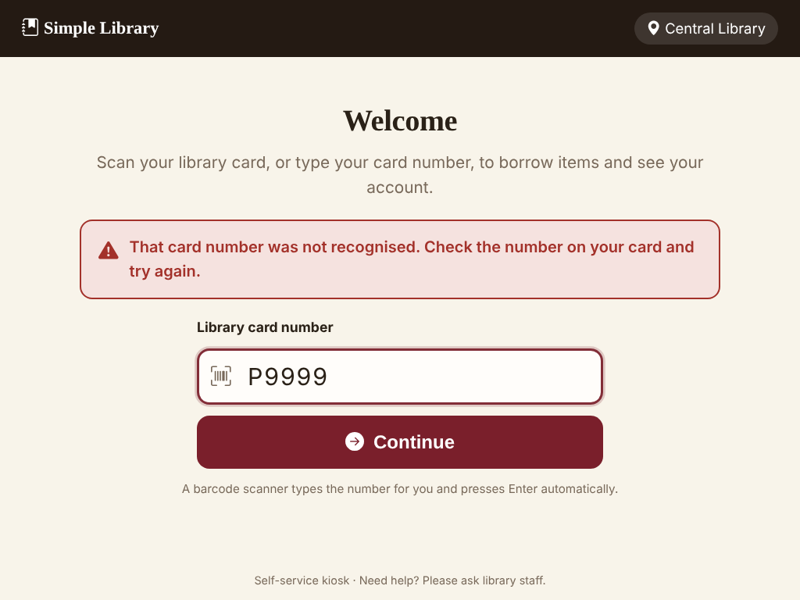
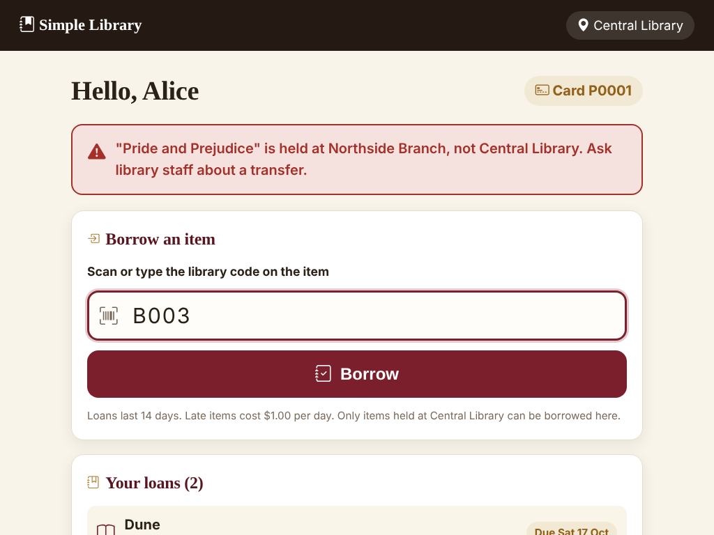

The kiosk works on phones and tablets too:

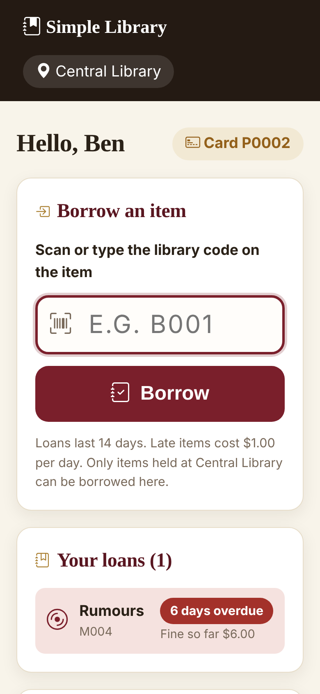

Fines are paid at the desk. The kiosk shows what you owe but cannot take payment.

---

## Part 2 - Library staff

### Finding a patron's card number
Open **Borrowers** (Reception, Manager or Admin). Each patron has a **Card number** column, for example `P0005`. Patrons can then use that number at the kiosk.

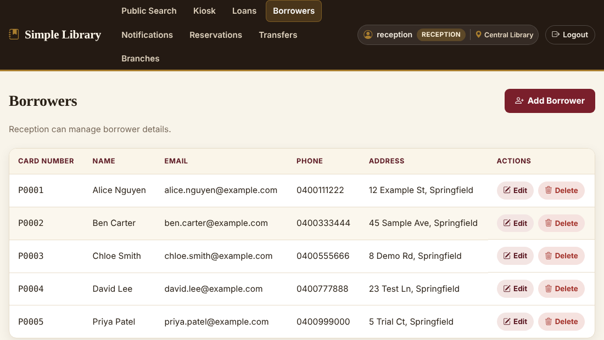

### Importing items from a CSV file (Admin only)
Log in as `admin` and open **Import** in the menu.

1. **Get the template.** Click **Download template**. It has the right column headings and one example row for each of Book, Music and Toy.
2. **Fill it in.** One item per row. Required for every row: `Type` (Book, Music or Toy), `Name`, `Description`, `LibraryCode`. Optional: `BranchCode` (blank means Central) and `Status` (Available or Damaged; blank means Available). Then the columns for the type:

   | Type | Columns |
   |---|---|
   | Book | `Author`, `Genre`, `PublicationYear` |
   | Music | `Artist`, `Genre`, `ReleaseYear` |
   | Toy | `ToyType`, `MinimumAge`, `Manufacturer` |

3. **Save as CSV UTF-8.** In Excel: File, Save As, "CSV UTF-8 (Comma delimited)". Files must be under 1 MB and 1000 rows.
4. **Check first.** On the Import page choose your file, tick **Check the file only** and click Upload. Nothing is saved; you get a line-by-line report.

   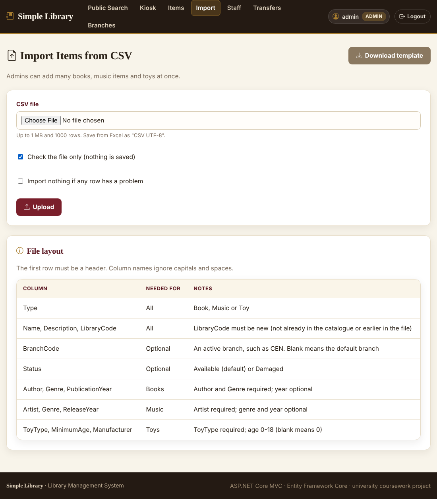
   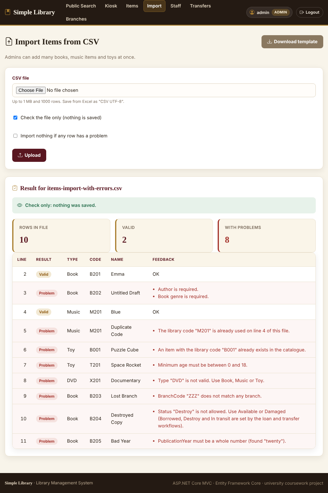

5. **Fix problems.** Each problem row shows its line number and every reason, such as "BranchCode "ZZZ" does not match any branch" or "The library code "B001" already exists in the catalogue". Fix the spreadsheet.
6. **Import.** Upload again with **Check the file only** unticked.
   - Leave **Stop if any row is invalid** unticked to save the good rows and skip the bad ones.
   - Tick it to save nothing unless every row is valid.

   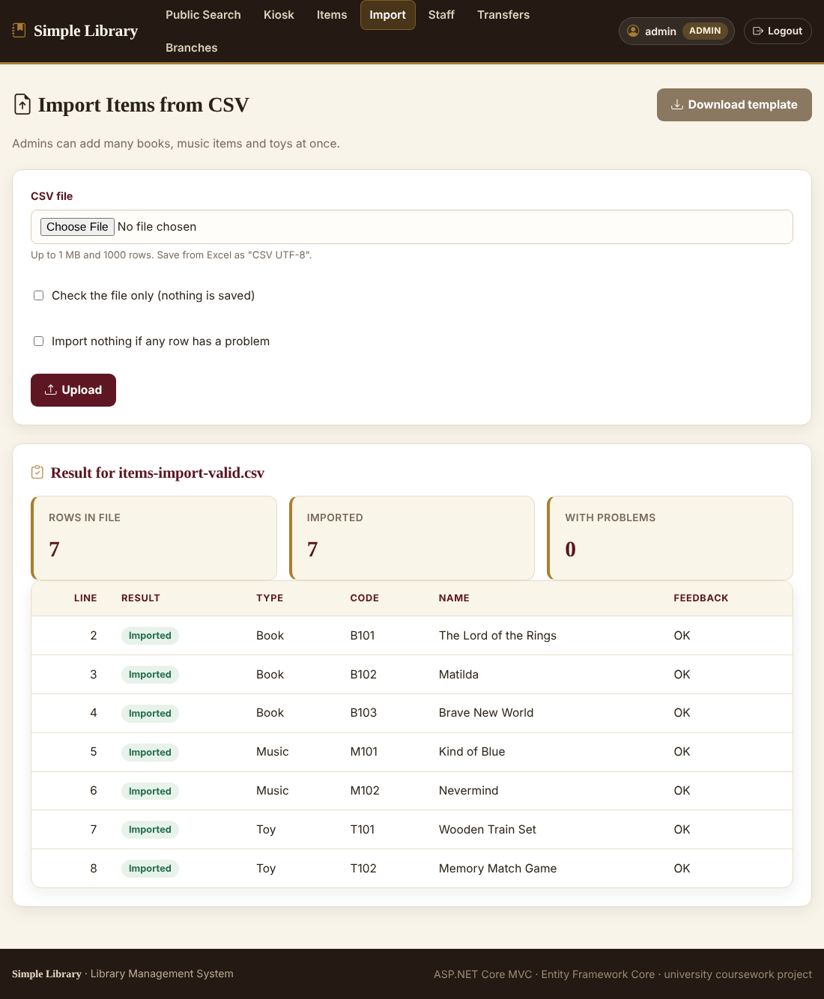

7. Open **Items** to see the new stock. Imports only add items; they cannot change existing ones.

Practice files are in `docs/samples/`: `items-import-valid.csv` (7 good rows) and `items-import-with-errors.csv` (10 rows with deliberate mistakes).

### Import problems and fixes
| Message | Fix |
|---|---|
| "The file is not UTF-8 text..." | Save as "CSV UTF-8" instead of plain CSV or .xlsx. |
| "The header row is missing required column(s)..." | Use the template headings exactly. |
| "The file has N rows. The limit is 1000..." | Split the file. |
| "This row has N values but the header has M columns..." | A value contains a comma. Put the value in quotes. |
| "Type "X" is not valid. Use Book, Music or Toy." | Correct the Type column. |
| "Status "X" is not allowed..." | Use Available or Damaged. Other statuses are set by loans and transfers. |

---

## Part 3 - Developers using the API
See [SECTION2_API.md](SECTION2_API.md). In short:

```bash
curl -H "X-Api-Key: demo-public-api-key-change-me" "http://localhost:5190/api/v1/items?availableOnly=true&branch=NTH"
```
