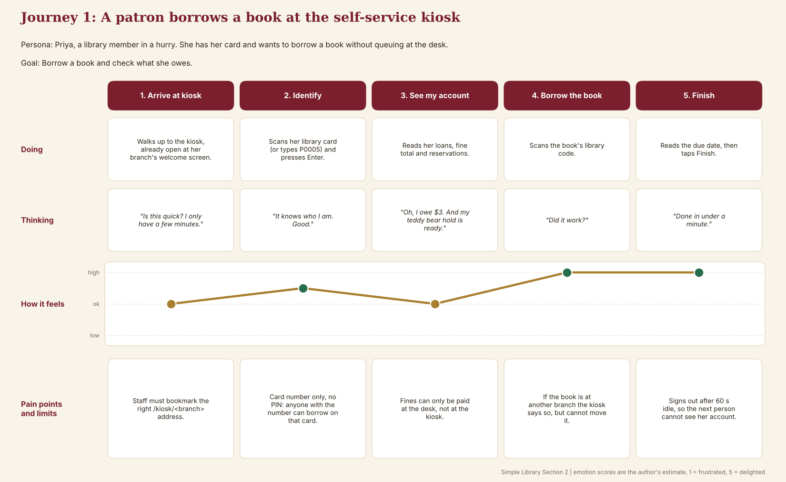
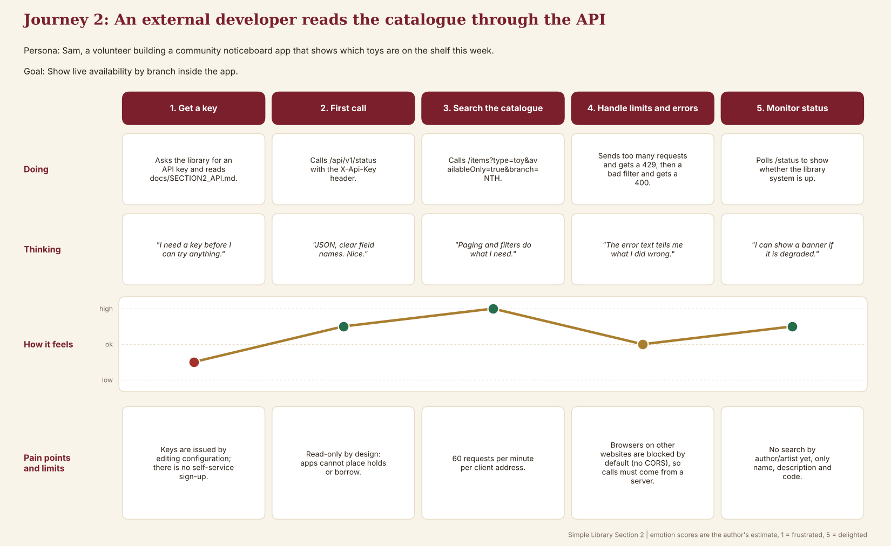
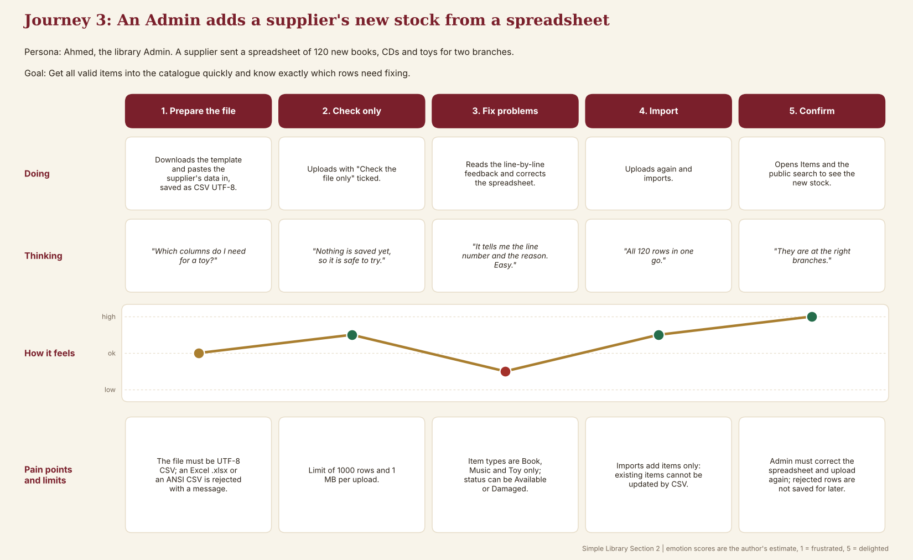

# Section 2 User Journey Maps

Three journeys cover the three features. Each map shows what the user does, thinks and feels at each stage, and the limits that get in their way. Emotion scores are the author's estimate (1 = frustrated, 5 = delighted).

## Journey 1 - A patron borrows a book at the kiosk
Persona: Priya, a library member in a hurry. Goal: borrow a book and check what she owes.

| Stage | Doing | Thinking | Feeling | Pain point / limit |
|---|---|---|---|---|
| Arrive at kiosk | Walks up to the kiosk, already open at her branch | "Is this quick?" | 3 | Staff must open the right `/kiosk/<branch>` address |
| Identify | Scans her card (or types P0005) | "It knows who I am." | 4 | Card number only, no PIN |
| See my account | Reads loans, fines, reservations | "I owe $3, and my hold is ready." | 3 | Fines are paid at the desk |
| Borrow the book | Scans the book's code | "Did it work?" | 5 | Items at another branch cannot be borrowed here |
| Finish | Reads the due date, taps Finish | "Done in under a minute." | 5 | Signs out after 60 s idle |

**Improvements this suggests:** add a PIN, and offer to place a hold from the kiosk.

## Journey 2 - A developer reads the catalogue through the API
Persona: Sam, a volunteer building a community noticeboard app. Goal: show live toy availability by branch.

| Stage | Doing | Thinking | Feeling | Pain point / limit |
|---|---|---|---|---|
| Get a key | Asks the library for a key, reads the API doc | "I need a key first." | 2 | Keys are issued by editing configuration |
| First call | Calls `/status` with `X-Api-Key` | "Clear field names. Nice." | 4 | Read-only: no holds or borrowing |
| Search the catalogue | `/items?type=toy&availableOnly=true&branch=NTH` | "Filters do what I need." | 5 | 60 requests per minute |
| Handle limits and errors | Gets a 429, then a 400 | "The error text tells me what I did wrong." | 3 | No CORS: calls must come from a server |
| Monitor status | Polls `/status` | "I can show a banner if degraded." | 4 | No search by author/artist yet |

**Improvements this suggests:** a self-service key page and author/artist search.

## Journey 3 - An Admin adds a supplier's stock from a spreadsheet
Persona: Ahmed, the library Admin. Goal: add 120 new items and know exactly which rows need fixing.

| Stage | Doing | Thinking | Feeling | Pain point / limit |
|---|---|---|---|---|
| Prepare the file | Downloads the template, pastes data in | "Which columns for a toy?" | 3 | Must be saved as CSV UTF-8 |
| Check only | Uploads with "Check the file only" | "Nothing is saved, safe to try." | 4 | 1000 rows / 1 MB limit |
| Fix problems | Reads line-by-line feedback, corrects the file | "It tells me the line and the reason." | 2 | Only Book, Music, Toy; Available or Damaged |
| Import | Uploads again | "All 120 rows in one go." | 4 | Adds items only; cannot update existing |
| Confirm | Checks Items and public search | "At the right branches." | 5 | Rejected rows are not kept for later |

**Improvements this suggests:** downloadable error report, and update-by-CSV.
